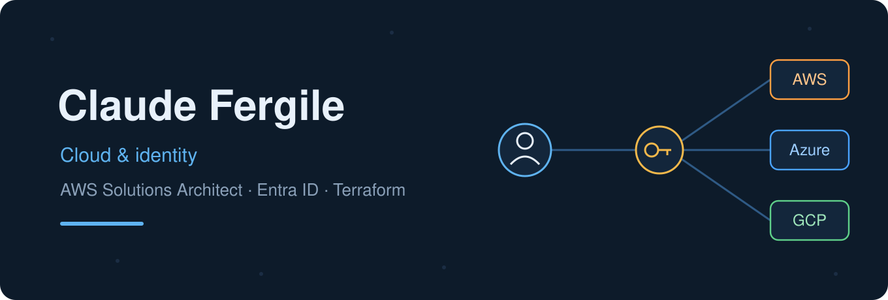

I support users and systems on an IT help desk by day and build cloud infrastructure the rest of the time. I like problems that cross layers — identity, networking, compute — and I document everything so the next person can reproduce it.

  

---

### 🧰 What I Work With

| Area | Tools |
|---|---|
| **Cloud** | AWS (VPC, EC2, S3, Site-to-Site VPN, IAM) · Google Cloud (VPC, Compute Engine, HA VPN, Cloud Router, load balancing, MIGs) |
| **Identity** | Microsoft Entra ID · Active Directory concepts · Microsoft Graph · MFA / SSO concepts |
| **Networking** | IPsec · BGP · CIDR planning · routing · firewall rules · load balancer health checks |
| **IaC & CI/CD** | Terraform · GitHub Actions |
| **Scripting & OS** | Bash · PowerShell · Linux · Windows |

---

### 🚀 Featured Projects

| Project | Highlights |
|---|---|
| [**Hybrid Cloud HA VPN: GCP ↔ AWS**](https://github.com/cfergile/TheoU_7.5_BaM_weekB/tree/main/14-Week14) | 4 redundant IPsec tunnels, 4 BGP sessions, dynamic route exchange, private VM ↔ EC2 traffic validated both ways |
| [**Autoscaling, Self-Healing Web Tier (Terraform)**](https://github.com/cfergile/TheoU_7.5_BaM_weekB/tree/main/10-Week10/terraform) | Global HTTP load balancer → regional MIG, CPU autoscaling (4–6), autohealing on `/healthz`, configured through variables |
| [**Troubleshooting a Broken Web Server**](https://github.com/cfergile/TheoU_7.5_BaM_weekB/blob/main/10-Week10/documentation/runbook.md) | Six stacked faults found layer by layer — firewall priority, source range, tags, external IP, missing default route |
| [**clauderesume.com**](https://github.com/cfergile/cloud-resume-challenge) | My résumé site on AWS S3, deployed automatically with GitHub Actions |

➡️ **Runbooks, screenshots and Terraform:** [TheoU_7.5_BaM_weekB](https://github.com/cfergile/TheoU_7.5_BaM_weekB)

---

### 🏅 Certifications

---

### 📊 GitHub Activity

  
  

---

### 📫 Let's Connect

